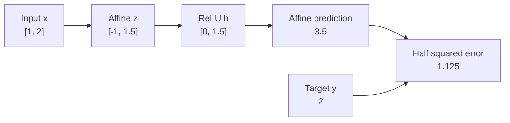

# Module 1 — From conventional ML to differentiable models

_Week 1 · Core lesson · Authored 1 November 2026 · Revised 3 November 2026_

[Read the formatted HTML lesson](01-from-conventional-ml-to-differentiable-models.html).

[Curriculum](../CURRICULUM.md) · [Content and learner progress](../PROGRESS.md)

## 🎯 Outcomes and starting point

You already know how to fit and evaluate predictive models. This module starts from that experience and explains what changes when the model learns intermediate features as well as a final predictor. You do not need prior knowledge of neural-network internals. We will introduce the matrix operations and derivatives as they become useful.

By the end, you should be able to:

- Explain what a multilayer perceptron learns beyond a linear predictor, and why its nonlinearities matter.
- Trace a network's inputs, preactivations, hidden representations and output, including tensor shapes.
- Derive how an early weight affects the loss through intermediate operations.
- Distinguish a forward pass, backpropagation, a parameter update and inference.
- Explain what adding width or depth changes, without assuming that a larger model is better.

The aim is to follow one small network all the way from its inputs to a prediction, then trace how the prediction error changes its weights. Keeping track of the intermediate values and their shapes will make each step easier to interpret.

## 🔍 The problem: useful features need not be obvious

Imagine predicting the severity of a surface defect from an inspection image. Each image is one **observation**. You extract two input features: contrast, denoted by $c$, and edge density, denoted by $e$. A linear regression model predicts a severity score $\hat y$ using a separate coefficient for each feature and a bias $b$:

$$
\hat y=b+w_c c+w_e e.
$$

Once the coefficients are fitted, increasing contrast by one unit changes the prediction by $w_c$, regardless of the edge density. The two coefficients need not be equal. The limitation is that contrast's effect cannot depend on edge density. Suppose contrast is informative about severity only when many edges are present. That is a **feature interaction**: the effect of one feature depends on another.

You could supply the additional feature $ce$ and fit its coefficient too. With a term $w_{ce}ce$, a one-unit increase in contrast changes the prediction by $w_c+w_{ce}e$, so its effect now depends on edge density. Choosing that product is **feature engineering**: you specify a transformation before fitting the predictor. A neural network offers another way to construct useful features by learning parameters of the transformations themselves.[^1]

We will use a network with **one hidden layer and one output layer**. The hidden layer transforms the input features into new numerical features; the output layer combines those learned features into a predicted severity score. The collection of hidden-layer outputs is called an **intermediate representation**. We count two layers with trainable parameters; the input itself is not counted as a layer in this convention.

This is a **feedforward network**: to make a prediction, we calculate the hidden features first and then use them to calculate the output, without looping back to an earlier layer. That order of calculation does not mean that training finishes learning the hidden features before fitting the output layer. Training adjusts parameters in both layers together, using the same prediction error.

Feature engineering and feature learning can therefore coexist. Here, you still supply contrast and edge density, extracted from the image using calculations you chose. The network learns transformations of those two features rather than learning directly from pixels. A learned feature need not have a human-readable name such as “scratch”: training rewards useful predictions without requiring each hidden feature to represent a concept we recognise.

We will first examine how these two layers calculate a prediction. Then we will answer the central learning question: how can the final prediction error tell the hidden layer's parameters which way to change?

## 🧱 Building the forward computation

### The hidden layer constructs learned features

The hidden layer begins with an operation you know from linear regression: multiply each input feature by a weight, add the results, and add a bias. A **hidden unit** performs one such calculation, then applies an activation function. Its output becomes one learned feature for the output layer.

Represent one observation by a column vector $x$ containing its $d$ input features. In our inspection task, $d=2$, with contrast in the first entry and edge density in the second. Let the hidden layer contain $m$ units. The number $m$ is its **width**, a design choice called a **hyperparameter**. You choose how many units exist; ordinary training learns their weights and biases rather than choosing their number. The width need not equal the number of input features. Each hidden unit needs $d$ weights, one for each input feature, and one bias. We will discuss how to choose the width after tracing the calculation.

We collect the hidden weights into a matrix $W_1$ with $m$ rows and $d$ columns. **Row $i$ contains the weights for hidden unit $i$.** The vector $b_1$ contains the $m$ biases. The subscript 1 identifies the hidden layer; later, $W_2$ and $b_2$ will hold the output layer's parameters. These symbols identify parameter arrays, not complete layers.

Matrix multiplication calculates all $m$ weighted sums at once. Call the resulting column vector $z$:

$$
z=W_1x+b_1,
\qquad x\in\mathbb{R}^{d},\quad W_1\in\mathbb{R}^{m\times d},\quad b_1\in\mathbb{R}^{m}.
$$

The notation $\mathbb{R}^{m\times d}$ means a matrix of real numbers with $m$ rows and $d$ columns. We treat $x$, $z$ and $b_1$ as column vectors, with shapes $d\times1$, $m\times1$ and $m\times1$. To see how the matrix equation produces one unit's weighted sum, write its $i$th entry separately:

$$
z_i=\sum_{j=1}^{d}(W_1)_{ij}x_j+(b_1)_i.
$$

Here, $x_j$ is input feature $j$, and $(W_1)_{ij}$ is the weight connecting that feature to unit $i$. The summation adds the $d$ weighted inputs; $(b_1)_i$ then adds that unit's bias. The bias allows a nonzero result even when all inputs are zero. A weighted sum plus a bias is called an **affine transformation**.

If we passed these weighted sums directly to another linear predictor, the combined model would still be linear regression on the original inputs. We will show why shortly. To allow a more flexible relationship, apply an **activation function**, a rule that transforms each weighted sum. We use the **rectified linear unit (ReLU)**: it outputs zero when its input is zero or negative, and leaves a positive input unchanged. Applying ReLU separately to each entry of $z$ produces the learned features in a column vector $h$:

$$
h_i=\operatorname{ReLU}(z_i)=\max(0,z_i).
$$

The values in $z$ are called **preactivations** because they come before the activation function. The values in $h$ are called **activations**: these are the hidden layer's $m$ learned feature values for this observation. For example, one unit could combine contrast and edge density and produce zero until that combination exceeds a threshold. Training adjusts the weights and bias, changing which input combinations produce a positive response. The layer is “hidden” because the training data supplies a target for the final output, not a target for each hidden feature.

To predict one numerical score, take a weighted sum of the hidden activations and add an output bias. Denote the prediction by $\hat y$, the output weights by $W_2$, and the output bias by $b_2$:

$$
\hat y=W_2h+b_2,
\qquad W_2\in\mathbb{R}^{1\times m},\quad b_2\in\mathbb{R}.
$$

The output weight matrix $W_2$ has one row because there is one predicted score, and $m$ columns because it receives $m$ hidden features. We leave this output affine so that the prediction can take any real value, as appropriate for the unrestricted regression score used here.

The full computation is therefore $x\rightarrow z\rightarrow h\rightarrow\hat y$: the hidden layer computes $h=\operatorname{ReLU}(W_1x+b_1)$, and the output layer computes $\hat y=W_2h+b_2$. This network is a **multilayer perceptron (MLP)**. Both layers are **dense**, meaning that each unit has a weight for every input from the preceding layer.[^2]

### Why the nonlinearity changes what can be represented

It may seem that stacking weighted sums already gives you a more flexible predictor. To check that idea, remove ReLU. The hidden vector then equals the first affine transformation, so you can substitute that expression into the output equation:

$$
\hat y=W_2(W_1x+b_1)+b_2
       =(W_2W_1)x+(W_2b_1+b_2).
$$

The product $W_2W_1$ acts as a new weight matrix, and $W_2b_1+b_2$ acts as a new bias. The prediction is still a weighted sum of the original input features plus a bias. For the inspection task, contrast still changes the prediction by the same amount at every value of edge density. Stacking affine layers has not allowed the model to express a feature interaction.[^2]

ReLU allows the prediction's sensitivity to an input feature to depend on the other inputs. A unit receiving contrast and edge density computes $h_i=\max(0,w_{ic}c+w_{ie}e+b_i)$, where $w_{ic}$ and $w_{ie}$ are that unit's two weights and $b_i$ is its bias. To make its behaviour concrete, choose illustrative weights $w_{ic}=w_{ie}=1$ and bias $b_i=-3$. This unit then computes $h_i=\max(0,c+e-3)$. These numbers make the arithmetic easy to follow; they are not fitted values or a requirement that weights equal one.

At edge density $e=0$, increasing contrast from 1 to 2 leaves this unit's output at zero. At $e=3$, the same contrast increase changes its output from 1 to 2. The response to contrast therefore depends on edge density.

For these chosen weights and bias, the output is zero when $c+e\leq3$ and positive when $c+e>3$. The line $c+e-3=0$ marks the switch between these two behaviours. We call it an **activation boundary**. For other parameter values, the boundary is $w_{ic}c+w_{ie}e+b_i=0$, the set of inputs where the unit's preactivation $z_i$ equals zero. With two input features and at least one nonzero weight, this boundary is a line; changing the weights can rotate it, and changing the bias shifts it. Training can therefore change which combinations of inputs activate the unit. This line describes one hidden unit's response, not a final classification decision.

Within a region where the same units remain active, each ReLU either passes through its weighted sum or outputs zero. The full prediction is affine within that region. Crossing an activation boundary can change which units contribute and hence change the prediction's slope. This is why a ReLU network is called **piecewise affine**: different input regions can use different affine relationships. It can approximate nonlinear relationships, but a finite ReLU network does not exactly reproduce every nonlinear function, such as a product, across a continuous input range.

### Shapes describe what the operations mean

So far, we have calculated a prediction for one observation. During training, we often calculate predictions for several observations together. Such a group is called a **batch**. To follow that calculation, we need to specify how the observations and their features are arranged.

A batch contains $B$ observations, each with $d$ input features. The number $B$ is the **batch size**. Arrange the observations as rows of a matrix $X$: entry $X_{ij}$ contains feature $j$ of observation $i$. Thus $X$ has $B$ rows and $d$ columns. Ten observations with two features each give a matrix of shape `(10, 2)`.

Numerical software, such as PyTorch, represents these values using arrays called **tensors**. A tensor's **shape** lists the size of each axis. For $X$, the first axis indexes observations and the second indexes input features. A matrix is represented as a two-axis tensor. A mathematical vector can be represented either as a one-axis array, such as `(d,)`, or with an explicit row or column orientation. Our earlier column vector uses shape `(d, 1)`, whereas a row vector uses `(1, d)`. We will keep the observation and feature axes explicit in the batch calculation.

Each row of $X$ is the transpose of the single-observation column vector used earlier. The superscript $T$ denotes a **transpose**, which exchanges rows and columns. Consequently, the row form of $z=W_1x+b_1$ is $z^T=x^TW_1^T+b_1^T$. Applying that same calculation to every observation gives the batch equations below. Uppercase $Z$ and $H$ contain the preactivations and activations for all observations; $\hat Y$ contains their predictions.

For the software-style batch equations below, represent the hidden biases $b_1$ as a one-axis array of shape `(m,)`, rather than the earlier column vector of shape `(m, 1)`. This array contains the same $m$ bias values, one per hidden unit. Adding $b_1$ means adding bias $i$ to hidden unit $i$'s weighted sum for every observation. The bias array has no observation axis; it is reused for each row of the batch:

$$
Z=XW_1^T+b_1,\qquad H=\operatorname{ReLU}(Z),\qquad
\hat Y=HW_2^T+b_2.
$$

| Quantity | Shape | Meaning |
| --- | --- | --- |
| $X$ | $B\times d$ | One observation per row; one input feature per column |
| $W_1$ | $m\times d$ | Hidden weights |
| $b_1$ | $(m,)$ in software | One bias per hidden unit, reused for every observation |
| $Z,H$ | $B\times m$ | One observation per row; one hidden unit per column |
| $W_2$ | $1\times m$ | Output weights |
| $\hat Y$ | $B\times1$ | Predictions |
| $Y$ | $B\times1$ | Targets |
| Mean batch loss | Scalar | Training objective for batch |

The target matrix $Y$ also has one row per observation and one column for the severity score. The same weights are used for every observation: batching evaluates one model on several observations together.

For instance, if two observations produce weighted sums `[2, 5]` and `[4, 7]`, adding the illustrative bias array `[0.1, 0.2]` gives `[2.1, 5.2]` and `[4.1, 7.2]`. Both rows use the same biases. This reuse across compatible array dimensions is called **broadcasting**; it avoids explicitly constructing $B$ copies of the bias array. The scalar output bias $b_2$ is likewise added to every prediction. PyTorch's `Linear(d, m)` represents weights in the $m\times d$ orientation used here and applies them to each observation's $d$ features.[^3]

Shapes also determine which values are compared when calculating errors. Predictions and targets should both have shape `(B, 1)` so each prediction is compared with its own target. If predictions have shape `(B, 1)` but targets have shape `(B,)`, broadcasting instead produces a `(B, B)` array: entry $(i,j)$ compares prediction $i$ with target $j$. For a batch of ten observations, that gives 100 pairwise errors instead of ten matched errors. The subtraction can run without a software error while computing the wrong quantity.

## 🧮 One network, traced through learning

We have established what both layers calculate and how their arrays are arranged. We will now use specific numbers to trace one observation through a prediction, calculate how each parameter affects its error, and update the parameters. All numbers are **synthetic**. Contrast and edge density have been scaled to dimensionless values, and the target is a defect-severity score in arbitrary units. The starting weights are chosen to make the arithmetic easy to follow; they were not fitted to real inspection data.

### 1. Forward pass: calculate the prediction

For this observation, contrast is $x_1=1$ and edge density is $x_2=2$. The known target score is $y=2$. We choose hidden width $m=2$ so that every calculation fits on the page, not because the input has two features. These two hidden units produce learned features for one output unit. The starting weights and biases are:

$$
x=\begin{bmatrix}1\\2\end{bmatrix},\quad y=2,\quad
W_1=\begin{bmatrix}1&-1\\0.5&0.5\end{bmatrix},\quad
b_1=\begin{bmatrix}0\\0\end{bmatrix},\quad
W_2=\begin{bmatrix}1&2\end{bmatrix},\quad b_2=0.5.
$$

There are $2\times2+2+1\times2+1=9$ trainable scalar parameters. The input and target are data, not trainable parameters.

First, calculate each hidden unit's weighted sum and then apply ReLU. The first row of $W_1$ subtracts the second input from the first; the second row takes half of each input:

$$
z=\begin{bmatrix}1(1)-1(2)\\0.5(1)+0.5(2)\end{bmatrix}
 =\begin{bmatrix}-1\\1.5\end{bmatrix},\qquad
h=\begin{bmatrix}0\\1.5\end{bmatrix}.
$$

The first preactivation is negative, so ReLU sets its activation to zero. The second is positive, so its activation stays at 1.5. The output layer combines those activations to predict the severity score:

$$
\hat y=1(0)+2(1.5)+0.5=3.5.
$$

The prediction, 3.5, is above the target of 2. To train the model, we need a **loss**: a numerical measure of prediction error that the learning procedure will try to reduce. We will use half squared error, denoted by $L$:

$$
L=\frac12(\hat y-y)^2=\frac12(3.5-2)^2=1.125.
$$

This loss has squared-score units. The factor $1/2$ simplifies its derivative; it is a convention, not part of the network architecture.



The arrows show which values each calculation uses: the prediction depends on $h$, which depends on $z$, which depends on the input and hidden parameters. To improve the prediction, we need to determine how changing each parameter changes the final loss. **Backpropagation** calculates these sensitivities by following the dependencies in reverse, starting at the loss.[^4]

### 2. Backward pass: calculate sensitivities

For one parameter $\theta$, the derivative $\partial L/\partial\theta$ tells you how the loss changes for a very small change in that parameter, keeping all other parameters fixed. The $\partial$ notation indicates that we are varying one quantity in a calculation that depends on several. Write the proposed parameter change as $\Delta\theta$, where $\Delta$ means “change in”:

$$
L(\theta+\Delta\theta)\approx L(\theta)
 +\frac{\partial L}{\partial\theta}\Delta\theta,
$$

The approximation says: start with the current loss, then add the derivative multiplied by the proposed change. A positive derivative means that increasing the parameter slightly will increase the loss locally, so a small decrease is a plausible way to reduce it. The derivative describes behaviour near the current parameter value; it is not a general importance score.

Start with the last operation, $L=\tfrac12(\hat y-y)^2$. Hold the target $y=2$ fixed and vary the prediction. Differentiating the square supplies a factor of 2, which cancels the factor $1/2$; the derivative of $\hat y-y$ with respect to $\hat y$ is 1. We will call the resulting loss sensitivity to the prediction $\delta$:

$$
\delta=\frac{\partial L}{\partial\hat y}=\hat y-y=1.5.
$$

Because $\delta$ is positive, lowering the prediction slightly would lower the loss. But we adjust weights, not the prediction directly. To connect a weight change to the loss, first work out how that weight changes the prediction, then how the prediction changes the loss.

Consider the second output weight, the entry in row 1, column 2 of $W_2$. Call this scalar $w_2=(W_2)_{12}$; its current value is 2. Expand the output equation so its contribution is visible:

$$
\hat y=(W_2)_{11}h_1+w_2h_2+b_2
      =1(0)+w_2(1.5)+0.5.
$$

Hold the hidden activations, output bias and other output weight fixed, and change only $w_2$ by $\Delta w_2$. The change affects just the term $w_2h_2$. Subtracting the old prediction from the new one gives:

$$
\Delta\hat y=(w_2+\Delta w_2)h_2-w_2h_2
             =h_2\Delta w_2=1.5\Delta w_2.
$$

This relationship is exact because the output is linear in $w_2$ when the other values are fixed. For instance, increasing $w_2$ from 2 to 2.01 gives $\Delta w_2=0.01$, so the prediction increases by $1.5(0.01)=0.015$, from 3.5 to 3.515. This is why $\partial\hat y/\partial w_2=h_2=1.5$: it is the prediction change per unit change in this weight.

Now connect that prediction change to the loss. For a small change, the derivative $\delta$ gives the first-order approximation:

$$
\Delta L\approx\delta\,\Delta\hat y
             =\delta h_2\Delta w_2.
$$

For the illustrative change of 0.01, the predicted loss increase is $1.5(0.015)=0.0225$. Recomputing the squared error gives an actual increase of $\tfrac12(3.515-2)^2-1.125=0.0226125$. The small difference comes from the square: the derivative describes the local rate of change, whereas this calculation uses a finite change.

The 0.01 change was a hypothetical check, not a training update. All derivatives below are evaluated at the original parameter values, including $w_2=2$; we will collect them before updating the network.

The coefficient of $\Delta w_2$ in the approximation is the loss derivative for this weight. Multiplying the two successive rates of change is the **chain rule**:

$$
\frac{\partial L}{\partial w_2}
=\frac{\partial L}{\partial\hat y}
 \frac{\partial\hat y}{\partial w_2}
=\delta h_2=1.5(1.5)=2.25.
$$

The two factors happen to have the same numerical value here, but they mean different things. The first, $\delta=\hat y-y=1.5$, measures how the loss responds to the prediction. The second, $h_2=1.5$, measures how the prediction responds to $w_2$. Their product measures how the loss responds to $w_2$.

The first output weight multiplies $h_1=0$, so changing that weight alone leaves the prediction unchanged for this observation; its loss derivative is zero. Increasing $b_2$ changes the prediction by exactly the same amount, so its loss derivative is $\delta(1)=1.5$.

We collect the loss derivatives for all entries of a parameter array into an array of the same shape, called its **gradient**. Each entry of $\partial L/\partial W_2$ therefore refers to the output weight in the corresponding position. The output-weight gradient and output-bias derivative are:

$$
\frac{\partial L}{\partial W_2}=\delta h^T
 =\begin{bmatrix}0&2.25\end{bmatrix},\qquad
\frac{\partial L}{\partial b_2}=\delta=1.5.
$$

To continue into the hidden layer, treat $h_2$ as the variable in the output equation while keeping the output weights, output bias and $h_1$ fixed. The term $w_2h_2$ now gives $\Delta\hat y=w_2\Delta h_2=2\Delta h_2$. Multiplying by the loss sensitivity $\delta=1.5$ gives $\partial L/\partial h_2=1.5(2)=3$. The first hidden activation has output weight 1, so its loss derivative is $1.5(1)=1.5$. Collecting these sensitivities gives the gradient with respect to $h$, with one entry per hidden activation:

$$
\frac{\partial L}{\partial h}=W_2^T\delta
 =\begin{bmatrix}1.5\\3\end{bmatrix}.
$$

Next, connect each preactivation to its hidden activation through ReLU. The second unit has $z_2=1.5>0$, so $h_2=z_2$. As long as the change does not cross zero, $\Delta h_2=\Delta z_2$: the derivative is 1. We already know that the loss sensitivity to $h_2$ is 3, so the loss sensitivity to $z_2$ is $3(1)=3$.

For the first unit, $z_1=-1$. A small change that keeps $z_1$ negative leaves $h_1=0$, so $\Delta h_1=0$ and the ReLU derivative is 0. The loss sensitivity to $z_1$ is therefore $1.5(0)=0$. At zero, ReLU has a corner and no unique derivative; an implementation must choose a convention. Neither preactivation here is zero.

Multiply each activation sensitivity by the derivative of its own ReLU. Denote the resulting preactivation sensitivities by $g_z$, and use $\odot$ for elementwise multiplication:

$$
g_z=\frac{\partial L}{\partial z}
 =\frac{\partial L}{\partial h}\odot
   \begin{bmatrix}0\\1\end{bmatrix}
 =\begin{bmatrix}0\\3\end{bmatrix}.
$$

We can now reach a hidden weight by the same two-step reasoning. Consider $(W_1)_{22}$, the connection from input $x_2$ to hidden unit 2. The unit computes $z_2=(W_1)_{21}x_1+(W_1)_{22}x_2+(b_1)_2$. Holding the inputs and other parameters fixed, changing this weight changes $z_2$ by $x_2=2$ times the weight change. Since the loss sensitivity to $z_2$ is 3, the loss derivative for this weight is $3(2)=6$.

For unit 2's first weight, the input multiplier is $x_1=1$, giving derivative $3(1)=3$. Each hidden bias changes its unit's preactivation by the same amount, so its derivative is that unit's preactivation sensitivity. Both weights and the bias of unit 1 receive zero loss derivative because its ReLU output does not change for these small perturbations. In general, the derivative for hidden weight $(W_1)_{ij}$ is $(g_z)_i x_j$. Collecting those entries gives:

$$
\frac{\partial L}{\partial W_1}=g_zx^T
 =\begin{bmatrix}0&0\\3&6\end{bmatrix},\qquad
\frac{\partial L}{\partial b_1}=g_z
 =\begin{bmatrix}0\\3\end{bmatrix}.
$$

The expression $g_zx^T$ is an **outer product**: each entry of the column vector $g_z$ multiplies every entry of the row vector $x^T$. Its shape is $(2\times1)(1\times2)=2\times2$, matching $W_1$. Each entry is the loss sensitivity for the weight in the same position in $W_1$.

The derivative for $(W_1)_{22}$ can also be written as one complete chain from the weight to the loss. Each factor is a rate of change for one link that we have just calculated:

$$
\frac{\partial L}{\partial(W_1)_{22}}
=\underbrace{\frac{\partial L}{\partial\hat y}}_{1.5}
 \underbrace{\frac{\partial\hat y}{\partial h_2}}_{2}
 \underbrace{\frac{\partial h_2}{\partial z_2}}_{1}
 \underbrace{\frac{\partial z_2}{\partial(W_1)_{22}}}_{x_2=2}
=6.
$$

The product gives 6, matching the matrix calculation. It explains how a final prediction error can guide an early weight: the chain rule connects that weight to the error through the intervening operations. Backpropagation organises the calculations so shared intermediate sensitivities can be reused. When a value affects the loss along several paths, their derivative contributions are added.[^4]

Notice the distinction between $\partial L/\partial h_1=1.5$ and $\partial L/\partial z_1=0$. Changing the hidden output would affect the loss, but small changes to its negative preactivation leave its ReLU output at zero. Its input weights therefore receive zero loss gradient from this observation. Another observation may activate it; one zero gradient does not establish that a unit is permanently inactive.

### 3. Parameter update: use the gradients

Calculating a gradient does not yet change the network. An optimisation rule must use it to update the parameters. **Gradient descent** subtracts a multiple of each parameter's derivative, moving in the direction that locally reduces the loss. The positive multiplier $\eta$ is the **learning rate**: it controls the size of the step.

If we collect all weights and biases into a vector $\theta$, the update can be written in one line. The notation $\nabla_\theta L$ denotes the vector of their loss derivatives:

$$
\theta_{\mathrm{new}}=\theta_{\mathrm{old}}-\eta\nabla_\theta L.
$$

Calculate every derivative at the old parameter values, then apply the update to all parameters. With the illustrative learning rate $\eta=0.05$, the second hidden unit's first weight changes from 0.5 to $0.5-0.05(3)=0.35$. Applying the same rule to the other entries gives:

$$
W_1'=\begin{bmatrix}1&-1\\0.35&0.20\end{bmatrix},\quad
b_1'=\begin{bmatrix}0\\-0.15\end{bmatrix},\quad
W_2'=\begin{bmatrix}1&1.8875\end{bmatrix},\quad b_2'=0.425.
$$

Recompute the forward pass with these new parameters:

$$
z'=\begin{bmatrix}-1\\0.35(1)+0.20(2)-0.15\end{bmatrix}
  =\begin{bmatrix}-1\\0.6\end{bmatrix},\qquad
h'=\begin{bmatrix}0\\0.6\end{bmatrix},
$$

$$
\hat y'=1.8875(0.6)+0.425=1.5575,\qquad
L'=\frac12(1.5575-2)^2=0.097903125.
$$

The new prediction is below the target, but closer to it, so its squared error is smaller. This step succeeded for the chosen example and learning rate. A larger step could increase the loss because the derivative describes local behaviour, not the effect of an arbitrarily large change. Even a successful training update does not establish that predictions will improve on validation data.[^5]

For the same observation, the learned feature $h_2$ fell from $1.5$ to $0.6$ because its hidden weights and bias changed. The output weights and bias also changed in this update. This is the joint feature learning described earlier: both the calculation that produces a hidden feature and the calculation that uses it for prediction are adjusted from the same loss.

## ⚙️ Computation graphs and automatic differentiation

We calculated nine parameter derivatives by hand. A larger network may contain millions of parameters, so repeating that process manually would be impractical. The computation graph provides a way to automate it: it records which operations produced each value, as in the forward-pass diagram above.

For each operation, software implements both the forward calculation and a rule for calculating derivatives with respect to its inputs. Combining those rules through the chain rule is called **automatic differentiation (AD)**. Backpropagation is the reverse-mode use of AD for calculating a loss's parameter gradients, following the dependencies from output toward input. PyTorch provides this through its autograd system.[^6]

AD does not estimate every derivative by repeatedly nudging parameters and measuring the loss. It applies derivative rules to the operations in the graph. It also does not need to simplify the whole network into one symbolic expression before differentiating it.

The training procedure below puts the stages in order. It is explanatory pseudocode rather than an executable program; `@` denotes matrix multiplication and `.T` denotes a transpose:

```text
for each training batch X, Y:
    clear previously accumulated parameter gradients
    H = ReLU(X @ W1.T + b1)
    predictions = H @ W2.T + b2
    loss = mean(0.5 * (predictions - Y)^2)
    compute gradients of loss with respect to W1, b1, W2, b2
    update those parameters using the chosen optimiser
```

For the batch loss shown here, you average the losses of the $B$ observations. Differentiating that average also averages their gradient contributions. Our numerical example has $B=1$, so there is only one contribution. In a larger batch, another observation may activate a unit that was inactive for this one and give its weights a nonzero gradient.

When you read a PyTorch training loop, `loss.backward()` is the gradient calculation. The optimiser's update is a separate operation. The pseudocode clears old gradients because PyTorch accumulates parameter gradients unless you clear them.[^6]

After training, you can use the fitted network to predict scores for new inputs. This application is called **inference**. For ordinary inference, the parameters stay fixed, and a forward pass can run under `torch.no_grad()` without recording gradients.[^6]

Keep four decisions separate:

| Decision | This example | What changing it changes |
| --- | --- | --- |
| Architecture | Dense → ReLU → dense | Family of possible mappings |
| Objective | Half squared error | What error is penalised |
| Optimisation | Gradient descent, $\eta=0.05$ | How parameters are updated |
| Inference procedure | Fixed-parameter forward pass | How a fitted model is applied |

Backpropagation computes gradients for an objective and graph. It does not choose the architecture, learning rate or evaluation design.

## ⚖️ Width, depth and engineering choices

The worked network used two hidden units, but we could choose a different width or add another hidden layer. Increasing hidden width gives the output layer more learned features to combine. Each added unit can learn a different weighted combination of inputs and a different activation boundary, although training may produce redundant or unused units. More units also add trainable parameters. For $d$ input features, one hidden layer of width $m$ and one output unit, count the hidden weights, hidden biases, output weights and output bias in that order:

$$
dm+m+m+1=m(d+2)+1.
$$

With our two input features, width $m=2$ gives 9 parameters, while $m=32$ gives 129. The input dimension tells you how many weights each hidden unit needs; it does not determine how many learned features will be useful. Width is selected as a hyperparameter rather than calculated from a universal input-size formula.[^2]

For a small tabular MLP, a practical starting comparison is one hidden layer with a few widely spaced widths. For example, $m=4,8,16,32,64$ is an illustrative search range, not a requirement or an established optimum for this task. Doubling the width explores different model sizes without testing every integer. Compare validation performance using the same data splits and metric, and repeat promising configurations with several random initialisations so one fortunate run does not decide the choice. If validation performance is effectively tied, the smaller network may be preferable for its lower compute and memory cost.[^7]

Interpret the training and validation results together. If increasing width improves both, the model may benefit from more capacity. If training error falls while validation error rises, the extra flexibility is fitting patterns that do not transfer. If both errors remain high, width is only one possible problem: feature scaling, learning rate, regularisation or insufficient training may prevent a suitable network from fitting. Module 2 explains how to investigate those training problems. A wider network is not guaranteed to generalise worse or better; width must be evaluated with the training procedure and available data.[^2][^7]

Increasing **depth** adds successive learned transformations. An extra nonlinear hidden layer receives the features formed by the previous layer, so it can build combinations of those features rather than working directly from the original inputs. Depth conventions differ: our network has one hidden layer and two affine layers. State what you are counting when comparing designs.[^2]

Width and depth therefore offer different ways to represent a function. Neither guarantees a better fitted model. A useful design must also be trainable with the available data and resources, and its predictions must hold up under validation.

Parameter cost matters if we replace our two engineered input features with image pixels. A $64\times64$ RGB image has three colour values at each pixel location. Arranging those values into one input vector, called **flattening**, produces $64\times64\times3=12{,}288$ input features. Connecting them to $128$ hidden units requires $12{,}288\times128+128=1{,}572{,}992$ parameters in the hidden layer alone. Each input position has its own weights, so learning to respond to a scratch in one location does not require the dense layer to use the same calculation elsewhere. Module 4 will explain how convolution reuses the same weights across spatial locations.

For the inspection task, keep simpler models as baselines. If a few engineered input features capture the useful information, learning many additional features may add complexity without improving validation performance. If you need to learn from image structure, a dense network's separate weight for every pixel position may be a poor fit. The following choices are starting judgements to test, not claims that one method will win:

| Situation | Reasonable starting choice | Main limitation to examine |
| --- | --- | --- |
| Few engineered features; approximately additive relationship | Linear model with suitable transforms | Missed nonlinear structure |
| Tabular input features; useful conditional interactions | Boosted-tree baseline | Fit to validation setting and deployment needs |
| Jointly learned continuous transformations are useful | MLP | Trainability, data sufficiency and parameter cost |
| Spatial structure is central | Compare with a convolutional model | Whether locality and sharing suit the task |

A network's features are shaped by what helps reduce the training objective. If an irrelevant pattern predicts the labels in your training data, the network may use it. An active hidden unit therefore shows that a calculation occurred; it does not by itself show that the network recognised a meaningful defect. You still need validation and error analysis to judge whether the learned features support reliable predictions.

## 🔗 What to carry forward

A feedforward network makes a prediction through a sequence of transformations, with information moving from input to output. Its nonlinearities let the prediction respond differently in different input regions. During learning, the chain rule connects the final loss to the weights in those earlier transformations, allowing the hidden features and the output predictor to change together.

Keep the three stages distinct: the forward pass calculates values, the backward pass calculates derivatives, and the optimiser changes parameters. The worked example showed why the distinction matters: an inactive ReLU can block a weight's loss gradient for one observation even when changing the unit's output would affect the prediction. Module 2 builds on this mechanism to explain why some networks are harder to train and what can make them more trainable.

## 📚 References

The numerical example and derivations are original teaching material. The sources below explain the underlying mechanisms and the PyTorch interfaces mentioned in the lesson. Sources were rechecked on **2 November 2026**; the example is illustrative and does not report results from a fitted inspection model.

[^1]: Goodfellow, I., Bengio, Y. and Courville, A. (2016). *Deep Learning*, Chapter 6, introduction and feature-learning discussion. [Deep feedforward networks](https://www.deeplearningbook.org/contents/mlp.html).
[^2]: Stanford CS231n. Undated course notes. [Neural networks, Part 1: architecture, activations and representational power](https://cs231n.github.io/neural-networks-1/).
[^3]: PyTorch. Version 2.9 documentation. [torch.nn.Linear: affine transformation and parameter shapes](https://docs.pytorch.org/docs/2.9/generated/torch.nn.Linear.html). Version-specific documentation is cited for the shape convention, not as a claim about the newest release.
[^4]: Stanford CS231n. Undated course notes. [Backpropagation, intuitions and staged computation](https://cs231n.github.io/optimization-2/).
[^5]: Goodfellow, I., Bengio, Y. and Courville, A. (2016). *Deep Learning*, Chapter 8, especially §8.1 on optimisation and generalisation. [Optimisation for training deep models](https://www.deeplearningbook.org/contents/optimization.html).
[^6]: PyTorch Tutorials. [Automatic differentiation with torch.autograd](https://docs.pytorch.org/tutorials/beginner/basics/autogradqs_tutorial.html). Consulted for graph tracking, backward computation, gradient accumulation and disabling tracking.
[^7]: Scikit-learn. User Guide, “Neural network models (supervised),” especially complexity and practical-use guidance. [MLP hyperparameters, initialisation, scaling and model selection](https://scikit-learn.org/stable/modules/neural_networks_supervised.html#tips-on-practical-use). Accessed 2 November 2026. The illustrative width range above is a teaching suggestion, not a prescribed range from this documentation.
