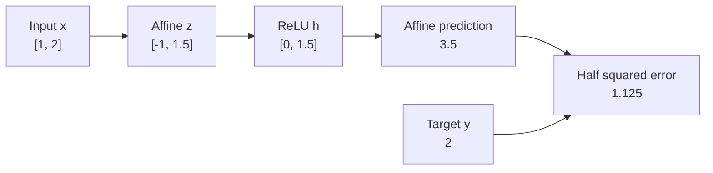

# Module 1 — From conventional ML to differentiable models

_Week 1 · Core lesson · Authored 1 November 2026_

[Read the formatted HTML lesson](01-from-conventional-ml-to-differentiable-models.html).

[Curriculum](../CURRICULUM.md) · [Content and learner progress](../PROGRESS.md)

## 🎯 Outcomes and starting point

You already know how to fit and evaluate predictive models. This module starts from that experience and explains what changes when the model learns intermediate features as well as a final predictor. You do not need prior knowledge of neural-network internals. We will introduce the matrix operations and derivatives as they become useful.

By the end, you should be able to:

- Explain what a multilayer perceptron learns beyond a linear predictor, and why its nonlinearities matter.
- Trace a network's inputs, preactivations, hidden representations and output, including tensor shapes.
- Derive how an early weight affects the loss through intermediate operations.
- Distinguish a forward pass, backpropagation, a parameter update and inference.
- Explain what adding width or depth changes, without assuming that a larger model is better.

The aim is to follow one small network all the way from its inputs to a prediction, then trace how the prediction error changes its weights. Keeping track of the intermediate values and their shapes will make each step easier to interpret.

## 🔍 The problem: useful features need not be obvious

Imagine predicting the severity of a surface defect from an inspection image. You could extract descriptors such as contrast and edge density, then fit a linear regression model. In that model, increasing contrast by one unit has the same predicted effect at every level of edge density. That restriction may be unsuitable if high contrast signals a defect only when many edges are also present.

You could address the restriction by designing interaction terms or other transformed features. But that requires you to choose useful transformations before fitting the predictor. A neural network gives you another option: let the training objective help shape those transformations.

A neural network introduces an **intermediate representation**, a collection of derived features whose parameters are learned together with the final predictor. Instead of fixing every feature transformation, you specify a family of transformations and fit their parameters using the prediction objective. We will use a **feedforward network**: values pass from input toward output through successive stages, without looping back into an earlier stage.[^1]

For example, an intermediate feature could be zero below a threshold and increase above it, with the threshold applied to a weighted combination of contrast and edge density. Training can adjust both the combination and its threshold. A later stage can then use that response to make a prediction.

Feature engineering and feature learning can therefore coexist. In our example, you still supply two engineered image descriptors. The network learns how to transform and combine them; it does not discover its own image measurements directly from pixels.

Think of a network as an adjustable measurement pipeline. Early stages build measurements; later stages combine them into a prediction. The training signal adjusts the whole pipeline. The analogy has a limit: hidden units need not correspond to named concepts such as “scratch” or “roughness”, and the loss does not prescribe a unique internal explanation.

Our driving question is: How can one final prediction error tell an early transformation which way to change?

## 🧱 Building the forward computation

### An affine transformation makes weighted measurements

Start with the stage that combines the input descriptors. Put the $d$ input values for one example into a column vector $x$. If you want $m$ intermediate measurements, arrange their weights as $m$ rows of a matrix $W_1$. A vector $b_1$ supplies one offset for each measurement. Together they produce a vector $z$:

$$
z=W_1x+b_1,
\qquad x\in\mathbb{R}^{d},\quad W_1\in\mathbb{R}^{m\times d},\quad b_1\in\mathbb{R}^{m}.
$$

The notation $\mathbb{R}^{m\times d}$ means a matrix of real numbers with $m$ rows and $d$ columns. Multiplying it by the $d$ inputs produces $m$ values. To see what one row does, write the $i$th measurement separately:

$$
z_i=\sum_{j=1}^{d}(W_1)_{ij}x_j+(b_1)_i.
$$

Weights control sensitivity to inputs; the bias shifts the measurement's offset. This is an **affine** transformation: a linear transformation plus an offset. It need not pass through the origin.

Next, decide which measurements will contribute to the next stage. We will use the **rectified linear unit (ReLU)**, which replaces a negative value with zero and leaves a positive value unchanged. Apply the rule separately to every component of $z$ to obtain the hidden vector $h$:

$$
h_i=\operatorname{ReLU}(z_i)=\max(0,z_i).
$$

The values in $z$ are called **preactivations** because they come before the activation function. The values in $h$ are the resulting activations. A subscript, such as $h_i$, selects one component. The layer is “hidden” because the training data supplies a target for the final output, not a target value for each of these intermediate responses.

To predict one numerical score, take a weighted sum of the hidden activations and add an output bias. Denote the prediction by $\hat y$, the output weights by $W_2$, and the output bias by $b_2$:

$$
\hat y=W_2h+b_2,
\qquad W_2\in\mathbb{R}^{1\times m},\quad b_2\in\mathbb{R}.
$$

The two transformations, with ReLU between them, form a **multilayer perceptron (MLP)** with one hidden layer. The layers are called **dense** because each unit can use every input from the previous stage. We leave the output affine so that the prediction can take any real value, as appropriate for the unrestricted regression score used here.[^2]

### Why the nonlinearity changes what can be represented

It may seem that stacking weighted sums already gives you a more flexible predictor. To check that idea, remove ReLU. The hidden vector then equals the first affine transformation, so you can substitute that expression into the output equation:

$$
\hat y=W_2(W_1x+b_1)+b_2
       =(W_2W_1)x+(W_2b_1+b_2).
$$

The product $W_2W_1$ acts as a new weight matrix, and $W_2b_1+b_2$ acts as a new bias. The whole network therefore reduces to one affine transformation. There are more adjustable numbers, but the prediction still has a constant slope with respect to each input. Adding affine layers alone does not remove the restriction of the original linear regression model.[^2]

ReLU changes that result because a unit's contribution now depends on whether its preactivation is positive. The boundary $z_i=0$ separates the inputs that activate unit $i$ from those that do not. When an input crosses a boundary, the network can change its slope. The resulting predictor is **piecewise affine**: it is affine within a region where the same units remain active, but can have different slopes in another region.

Thus a hidden unit is more than a weighted sum: it is a weighted sum with input-dependent participation. Its boundary can move during training because both its weights and bias change.

### Shapes describe what the operations mean

A **tensor**, in the programming sense used here, is a multidimensional array. Its shape tells you the size of each axis. A vector of two descriptors has shape `(2,)`; a table of ten examples with two descriptors each has shape `(10, 2)`. Libraries may call the number of axes the tensor's rank. That usage is different from matrix rank in linear algebra.

During training, you usually process a **batch**, a group of examples evaluated together. Let $B$ be its size and put each example in a row of $X$. Earlier, one example was a column vector, so the matrix multiplication must now be written in the opposite orientation. The superscript $T$ denotes a transpose, which exchanges a matrix's rows and columns:

$$
Z=XW_1^T+b_1,\qquad H=\operatorname{ReLU}(Z),\qquad
\hat Y=HW_2^T+b_2.
$$

| Quantity | Shape | Meaning |
| --- | --- | --- |
| $X$ | $B\times d$ | Input examples |
| $W_1$ | $m\times d$ | Hidden weights |
| $b_1$ | $m$ | Hidden biases |
| $Z,H$ | $B\times m$ | Intermediate values |
| $W_2$ | $1\times m$ | Output weights |
| $\hat Y$ | $B\times1$ | Predictions |
| $Y$ | $B\times1$ | Targets |
| Mean batch loss | Scalar | Training objective for batch |

The uppercase letters $Z$ and $H$ collect the preactivations and activations for the whole batch. The weights are shared across examples: batching changes how many examples you evaluate together, not which model each example uses.

Adding $b_1$ **broadcasts** the same bias vector to every row. Broadcasting is an array rule that lets an operation reuse values across compatible dimensions without writing out each copy. PyTorch's `Linear(d, m)` uses the weight orientation shown here and transforms the final feature axis.[^3]

Broadcasting is convenient, but an operation can run successfully and still compare the wrong quantities. Subtracting predictions of shape `(B, 1)` from targets of shape `(B,)` can produce a `(B, B)` array, comparing every prediction with every target. Keep predictions and targets in the same `(B, 1)` shape when you want one error per example.

## 🧮 One network, traced through learning

We will now follow the inspection example through one prediction and one learning step. All numbers are **synthetic**. The two input descriptors have been scaled to dimensionless values, and the target is a defect-severity score in arbitrary units. The starting weights are chosen to make the arithmetic easy to follow; they were not fitted to real inspection data.

### 1. Forward pass: calculate the prediction

The input has values 1 and 2, and its target score is 2. The network has two hidden units and one output. Its starting weights and biases are:

$$
x=\begin{bmatrix}1\\2\end{bmatrix},\quad y=2,\quad
W_1=\begin{bmatrix}1&-1\\0.5&0.5\end{bmatrix},\quad
b_1=\begin{bmatrix}0\\0\end{bmatrix},\quad
W_2=\begin{bmatrix}1&2\end{bmatrix},\quad b_2=0.5.
$$

There are $2\times2+2+1\times2+1=9$ trainable scalar parameters. The input and target are data, not trainable parameters.

First, calculate each hidden unit's weighted sum and then apply ReLU. The first row of $W_1$ subtracts the second input from the first; the second row takes half of each input:

$$
z=\begin{bmatrix}1(1)-1(2)\\0.5(1)+0.5(2)\end{bmatrix}
 =\begin{bmatrix}-1\\1.5\end{bmatrix},\qquad
h=\begin{bmatrix}0\\1.5\end{bmatrix}.
$$

The first preactivation is negative, so ReLU sets its activation to zero. The second is positive, so its activation stays at 1.5. The output layer combines those activations to predict the severity score:

$$
\hat y=1(0)+2(1.5)+0.5=3.5.
$$

The prediction, 3.5, is above the target of 2. To train the model, we need a **loss**: a numerical measure of prediction error that the learning procedure will try to reduce. We will use half squared error, denoted by $L$:

$$
L=\frac12(\hat y-y)^2=\frac12(3.5-2)^2=1.125.
$$

This loss has squared-score units. The factor $1/2$ simplifies its derivative; it is a convention, not part of the network architecture.



The graph brings the forward calculations together. Follow the input through the hidden values to the predicted score, then to the loss. During learning, **backpropagation** follows these dependencies in reverse to calculate how sensitive the loss is to earlier values.[^4]

### 2. Backward pass: calculate sensitivities

We now need to decide how each weight and bias should change. For one parameter $\theta$, the derivative of the loss tells you how the loss would change if you moved that parameter by a very small amount, keeping the others fixed. Write the proposed change as $\Delta\theta$, where the symbol $\Delta$ means “change in”:

$$
L(\theta+\Delta\theta)\approx L(\theta)
 +\frac{\partial L}{\partial\theta}\Delta\theta,
$$

The approximation says: start with the current loss, then add the derivative multiplied by the proposed change. A positive derivative means that increasing the parameter slightly will increase the loss locally, so a small decrease is a plausible way to reduce it. The derivative describes behaviour near the current parameter value; it is not a general importance score.

Start with the last operation. For half squared error, differentiating with respect to the prediction leaves the prediction error itself. We will call this output sensitivity $\delta$:

$$
\delta=\frac{\partial L}{\partial\hat y}=\hat y-y=1.5.
$$

Because $\delta$ is positive, lowering the prediction slightly would lower the loss. To work out how an output weight can do that, use the fact that a weight multiplies its hidden activation. A small change in the second output weight therefore changes the prediction by 1.5 times that change. Multiplying by $\delta$ gives a loss sensitivity of 2.25. The first output weight multiplies a zero activation, so its sensitivity is zero:

$$
\frac{\partial L}{\partial W_2}=\delta h^T
 =\begin{bmatrix}0&2.25\end{bmatrix},\qquad
\frac{\partial L}{\partial b_2}=\delta=1.5.
$$

Changing the output bias changes the prediction by the same amount, which is why its derivative is just $\delta$. To continue into the hidden layer, ask how changing each hidden activation would change the prediction. Its output weight supplies that sensitivity, so multiplying the output weights by $\delta$ gives:

$$
\frac{\partial L}{\partial h}=W_2^T\delta
 =\begin{bmatrix}1.5\\3\end{bmatrix}.
$$

Next, pass those sensitivities through ReLU. For a negative preactivation, a small change leaves the activation at zero, so the derivative is $0$. For a positive preactivation, ReLU passes the change through unchanged, so the derivative is $1$. At zero, ReLU has a corner and no unique derivative; an implementation must choose a convention. Neither preactivation here is zero.

Multiply each activation sensitivity by the derivative of its own ReLU. Denote the resulting preactivation sensitivities by $g_z$, and use $\odot$ for elementwise multiplication:

$$
g_z=\frac{\partial L}{\partial z}
 =\frac{\partial L}{\partial h}\odot
   \begin{bmatrix}0\\1\end{bmatrix}
 =\begin{bmatrix}0\\3\end{bmatrix}.
$$

We can now reach the first layer's weights. Each weight contributes its input value to the derivative of its unit's preactivation. Multiply that input by the corresponding entry of $g_z$. This gives zero for both weights of the inactive first unit, and values 3 and 6 for the second unit's two weights:

$$
\frac{\partial L}{\partial W_1}=g_zx^T
 =\begin{bmatrix}0&0\\3&6\end{bmatrix},\qquad
\frac{\partial L}{\partial b_1}=g_z
 =\begin{bmatrix}0\\3\end{bmatrix}.
$$

The expression $g_zx^T$ is an **outer product**: each entry of the column vector $g_z$ multiplies every entry of the row vector $x^T$. Its shape is $(2\times1)(1\times2)=2\times2$, matching $W_1$. Together, the derivatives with respect to all entries of an array form its **gradient**. The gradient has the same shape as the parameter array, so each entry identifies the sensitivity of one parameter.

You can also trace one weight without the matrix notation. The subscript 22 in $(W_1)_{22}$ means the weight in row 2, column 2: the connection from the second input to the second hidden unit. To connect its change to the loss, multiply the sensitivities along its path. This is the **chain rule** for a composition of functions:

$$
\frac{\partial L}{\partial(W_1)_{22}}
=\underbrace{\frac{\partial L}{\partial\hat y}}_{1.5}
 \underbrace{\frac{\partial\hat y}{\partial h_2}}_{2}
 \underbrace{\frac{\partial h_2}{\partial z_2}}_{1}
 \underbrace{\frac{\partial z_2}{\partial(W_1)_{22}}}_{x_2=2}
=6.
$$

The product gives 6, matching the matrix calculation. It explains how a final prediction error can guide an early weight: the chain rule connects that weight to the error through the intervening operations. Backpropagation organises the calculations so shared intermediate sensitivities can be reused. When a value affects the loss along several paths, their derivative contributions are added.[^4]

Notice the distinction between $\partial L/\partial h_1=1.5$ and $\partial L/\partial z_1=0$. Changing the hidden output would affect the loss, but small changes to its negative preactivation leave its ReLU output at zero. Its input weights therefore receive zero loss gradient from this example. Another example may activate it; one zero gradient does not establish that a unit is permanently inactive.

### 3. Parameter update: use the gradients

Calculating a gradient does not yet change the network. An optimisation rule must use it to update the parameters. **Gradient descent** subtracts a multiple of each parameter's derivative, moving in the direction that locally reduces the loss. The positive multiplier $\eta$ is the **learning rate**: it controls the size of the step.

If we collect all weights and biases into a vector $\theta$, the update can be written in one line. The notation $\nabla_\theta L$ denotes the vector of their loss derivatives:

$$
\theta_{\mathrm{new}}=\theta_{\mathrm{old}}-\eta\nabla_\theta L.
$$

Calculate every derivative at the old parameter values, then apply the update to all parameters. With the illustrative learning rate $\eta=0.05$, the second hidden unit's first weight changes from 0.5 to $0.5-0.05(3)=0.35$. Applying the same rule to the other entries gives:

$$
W_1'=\begin{bmatrix}1&-1\\0.35&0.20\end{bmatrix},\quad
b_1'=\begin{bmatrix}0\\-0.15\end{bmatrix},\quad
W_2'=\begin{bmatrix}1&1.8875\end{bmatrix},\quad b_2'=0.425.
$$

Recompute the forward pass with these new parameters:

$$
z'=\begin{bmatrix}-1\\0.35(1)+0.20(2)-0.15\end{bmatrix}
  =\begin{bmatrix}-1\\0.6\end{bmatrix},\qquad
h'=\begin{bmatrix}0\\0.6\end{bmatrix},
$$

$$
\hat y'=1.8875(0.6)+0.425=1.5575,\qquad
L'=\frac12(1.5575-2)^2=0.097903125.
$$

The new prediction is below the target, but closer to it, so its squared error is smaller. This step succeeded for the chosen example and learning rate. A larger step could increase the loss because the derivative describes local behaviour, not the effect of an arbitrarily large change. Even a successful training update does not establish that predictions will improve on validation data.[^5]

Notice what changed inside the network: for the same input, $h_2$ fell from $1.5$ to $0.6$. The update changed the intermediate feature as well as the weights that read that feature. The hidden representation and the final predictor were both adjusted to reduce the same loss.

## ⚙️ Computation graphs and automatic differentiation

A computation graph records which operations produced each value. Each operation has a forward calculation and a rule for passing derivatives back to its inputs. Once those rules are available, software can combine them using the chain rule, following the same reasoning we used by hand. This process is called **automatic differentiation (AD)**. PyTorch provides it through its autograd system.[^6]

AD does not estimate every derivative by repeatedly nudging parameters and measuring the loss. It applies derivative rules to the operations in the graph. It also does not need to simplify the whole network into one symbolic expression before differentiating it.

The training procedure below puts the stages in order. It is explanatory pseudocode rather than an executable program; `@` denotes matrix multiplication and `.T` denotes a transpose:

```text
for each training batch X, Y:
    clear previously accumulated parameter gradients
    H = ReLU(X @ W1.T + b1)
    predictions = H @ W2.T + b2
    loss = mean(0.5 * (predictions - Y)^2)
    compute gradients of loss with respect to W1, b1, W2, b2
    update those parameters using the chosen optimiser
```

For the batch loss shown here, you average the per-example losses. Differentiating that average also averages the examples' gradient contributions. Our numerical example has $B=1$, so there is only one contribution. In a larger batch, another example may activate a unit that was inactive for this one and give its weights a nonzero gradient.

When you read a PyTorch training loop, `loss.backward()` is the gradient calculation. The optimiser's update is a separate operation. The pseudocode clears old gradients because PyTorch accumulates parameter gradients unless you clear them.[^6]

After training, you can use the fitted network to predict scores for new inputs. This application is called **inference**. For ordinary inference, the parameters stay fixed, and a forward pass can run under `torch.no_grad()` without recording gradients.[^6]

Keep four decisions separate:

| Decision | This example | What changing it changes |
| --- | --- | --- |
| Architecture | Dense → ReLU → dense | Family of possible mappings |
| Objective | Half squared error | What error is penalised |
| Optimisation | Gradient descent, $\eta=0.05$ | How parameters are updated |
| Inference procedure | Fixed-parameter forward pass | How a fitted model is applied |

Backpropagation computes gradients for an objective and graph. It does not choose the architecture, learning rate or evaluation design.

## ⚖️ Width, depth and engineering choices

Increasing **width**, the number of units in a hidden layer, gives that stage more intermediate responses to work with. It also adds weights. For $d$ inputs, one hidden layer of width $m$ and one output, count the input weights, hidden biases, output weights and output bias in that order:

$$
dm+m+m+1=m(d+2)+1.
$$

Increasing **depth** adds successive learned transformations. An extra nonlinear hidden layer receives the features formed by the previous layer, so it can build combinations of those features rather than working directly from the original inputs. Depth conventions differ: our network has one hidden layer and two affine layers. State what you are counting when comparing designs.[^2]

Width and depth therefore offer different ways to represent a function. Neither guarantees a better fitted model. A useful design must also be trainable with the available data and resources, and its predictions must hold up under validation.

The engineering constraint is visible in a simple calculation. Flattening a $64\times64$ RGB image produces $12{,}288$ inputs. Connecting these to $128$ hidden units requires $12{,}288\times128+128=1{,}572{,}992$ parameters in the first layer alone. It also gives each pixel location its own weights. The dense layer does not require nearby pixels to share a detector. Module 4 will introduce a different structural assumption through convolution.

For the inspection task, keep the simpler models as baselines. If a few descriptors capture the useful information, learning many intermediate features may add complexity without improving validation performance. If you need to learn from image structure, a dense network's separate weight for every pixel position may be a poor fit. The following choices are starting judgements to test, not claims that one method will win:

| Situation | Reasonable starting choice | Main limitation to examine |
| --- | --- | --- |
| Few descriptors; approximately additive relationship | Linear model with suitable transforms | Missed nonlinear structure |
| Tabular descriptors; useful conditional interactions | Boosted-tree baseline | Fit to validation setting and deployment needs |
| Jointly learned continuous transformations are useful | MLP | Trainability, data sufficiency and parameter cost |
| Spatial structure is central | Compare with a convolutional model | Whether locality and sharing suit the task |

A network's features are shaped by what helps reduce the training objective. If an irrelevant pattern predicts the labels in your training data, the network may use it. An active hidden unit therefore shows that a calculation occurred; it does not by itself show that the network recognised a meaningful defect. You still need validation and error analysis to judge whether the learned features support reliable predictions.

## 🔗 What to carry forward

A feedforward network makes a prediction through a sequence of transformations, with information moving from input to output. Its nonlinearities let the prediction respond differently in different input regions. During learning, the chain rule connects the final loss to the weights in those earlier transformations, allowing the hidden features and the output predictor to change together.

Keep the three stages distinct: the forward pass calculates values, the backward pass calculates derivatives, and the optimiser changes parameters. The worked example showed why the distinction matters: an inactive ReLU can block a weight's loss gradient for one example even when changing the unit's output would affect the prediction. Module 2 builds on this mechanism to explain why some networks are harder to train and what can make them more trainable.

## 📚 References

The numerical example and derivations are original teaching material. The sources below explain the underlying mechanisms and the PyTorch interfaces mentioned in the lesson. Sources were accessed on **1 November 2026**; the example is illustrative and does not report results from a fitted inspection model.

[^1]: Goodfellow, I., Bengio, Y. and Courville, A. (2016). *Deep Learning*, Chapter 6, introduction and feature-learning discussion. [Deep feedforward networks](https://www.deeplearningbook.org/contents/mlp.html).
[^2]: Stanford CS231n. Undated course notes. [Neural networks, Part 1: architecture, activations and representational power](https://cs231n.github.io/neural-networks-1/).
[^3]: PyTorch. Version 2.9 documentation. [torch.nn.Linear: affine transformation and parameter shapes](https://docs.pytorch.org/docs/2.9/generated/torch.nn.Linear.html). Version-specific documentation is cited for the shape convention, not as a claim about the newest release.
[^4]: Stanford CS231n. Undated course notes. [Backpropagation, intuitions and staged computation](https://cs231n.github.io/optimization-2/).
[^5]: Goodfellow, I., Bengio, Y. and Courville, A. (2016). *Deep Learning*, Chapter 8, especially §8.1 on optimisation and generalisation. [Optimisation for training deep models](https://www.deeplearningbook.org/contents/optimization.html).
[^6]: PyTorch Tutorials. [Automatic differentiation with torch.autograd](https://docs.pytorch.org/tutorials/beginner/basics/autogradqs_tutorial.html). Consulted for graph tracking, backward computation, gradient accumulation and disabling tracking.
